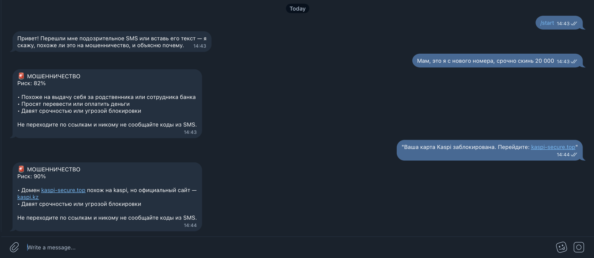

# Scam SMS Detector

Detects fraudulent SMS messages in **Russian, Kazakh and English** and explains *why* a message looks like fraud.

Built for the kinds of scams common in Kazakhstan: fake bank alerts with look-alike links (`kaspi-secure.top`), requests to dictate an SMS code, "relative in trouble" messages from a new number, fake parcel and customs fees, prize scams.

```
Input:  "Ваша карта Kaspi заблокирована. Перейдите: kaspi-secure.top"
Output: МОШЕННИЧЕСТВО — risk 91%
        • Домен kaspi-secure.top похож на kaspi, но официальный сайт — kaspi.kz
        • Давят срочностью или угрозой блокировки
```

Comes with a **web page**, a **JSON API** and a **Telegram bot**.



## How it works

The detector combines two independent signals:

| Part | What it does | Why |
|---|---|---|
| **ML model** | TF-IDF on character n-grams (2–5) → Logistic Regression | Character n-grams handle three languages at once and survive typos and tricks like `k4spi` |
| **Red-flag rules** | Regex checks: look-alike and shortened links, IP links, requests for codes or card data, urgency, prizes, payment requests, impersonation | Gives human-readable reasons, and catches schemes the model has not seen |

```
final_score = 0.6 × ML probability + 0.4 × rules score      → scam if ≥ 0.5
rules score = 1 − ∏(1 − weight of each red flag)
```

The rules avoid a classic false positive: a real bank SMS says *"никому не сообщайте код"* ("don't tell anyone the code"). That is a warning, not a request, so it is not flagged.

## Results

Held-out test set (`python train.py`):

| Test subset | Model | Accuracy | Precision | Recall | F1 |
|---|---|---|---|---|---|
| English, real SMS (n = 1115) | ML only | 0.992 | 0.993 | 0.946 | 0.969 |
| English, real SMS (n = 1115) | Hybrid | 0.986 | 1.000 | 0.893 | 0.943 |
| Russian/Kazakh, **unseen scheme types** (n = 99) | ML only | 0.849 | 0.789 | 1.000 | 0.882 |
| Russian/Kazakh, **unseen scheme types** (n = 99) | Hybrid | 0.960 | 0.933 | 1.000 | 0.966 |

**Takeaway:** on fraud schemes the model never saw during training, adding the rules cut false alarms from 15 to 4 and kept every scam caught. The rules are tuned for Russian/Kazakh fraud, so on English spam the hybrid trades some recall for zero false positives.

## Data

- **English:** [SMS Spam Collection](https://archive.ics.uci.edu/dataset/228/sms+spam+collection) (Almeida & Hidalgo, UCI, CC BY 4.0) — 5,574 real messages.
- **Russian/Kazakh:** there is no open labelled dataset of Kazakhstani scam SMS, so `data/generate_ru_kz.py` generates 505 messages from 48 templates (24 scam schemes, 24 normal message types) modelled on publicly reported fraud.
- To keep the evaluation honest, the Russian/Kazakh test set is split **by template**: the model is tested only on scheme types it has never seen, not on near-copies of training messages.

## Limitations

- Russian/Kazakh results come from synthetic data and a small test set (99 messages). Real-world accuracy needs real messages, for example from an operator's spam reports.
- The rules can be bypassed by a scammer who avoids every keyword. The ML part is there to cover that.
- Only text is analysed: the sender number and link reputation are not checked.

## Run it

```bash
pip install -r requirements.txt
python data/generate_ru_kz.py   # optional: the CSV is already included
python train.py                 # trains, prints metrics, saves models/scam_detector.joblib
python app.py                   # web demo at http://127.0.0.1:8000
pytest                          # 13 tests
```

**API**

```bash
curl -X POST http://127.0.0.1:8000/api/check -H "Content-Type: application/json" \
     -d '{"text": "Служба безопасности банка. Продиктуйте код из SMS"}'
```

**Telegram bot:** create a bot with [@BotFather](https://t.me/BotFather), then

```bash
export TELEGRAM_BOT_TOKEN="your-token"
python bot.py
```

## Project structure

```
data/            datasets + synthetic data generator
src/detector/    red_flags.py (rules) · model.py (ML + hybrid verdict)
train.py         training and evaluation
app.py           Flask web demo + JSON API
bot.py           Telegram bot
tests/           pytest tests
```

## Ideas for next steps

- Collect real Russian/Kazakh scam SMS to replace the synthetic data
- Check links against a phishing blocklist and domain age
- Add sender-number reputation

## Author

Torezhan Yelamanov — cybersecurity student, Narxoz University (Almaty).
